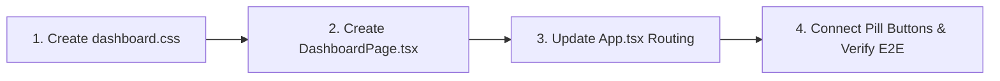

# Money Boys — In-App Dashboard & Sandbox UI Handoff

> **Handoff Target:** Next Agent / Pair Programmer  
> **Mission:** Finalize the In-App Dashboard & Sandbox UI, connect the landing page's pill buttons, and verify all automated tests.  
> **Governing Spec:** [`docs/DASHBOARD_SANDBOX_SPECIFICATION.md`](./DASHBOARD_SANDBOX_SPECIFICATION.md)  
> **Visual Reference:** Lunor Dark Management Interface ([Pinterest Reference](https://pin.it/218ZrvUON))

---

## 1. Current State & Completed Artifacts

The architectural and logic groundwork is complete and compiles cleanly (`tsc --noEmit` exits with 0). No simulated mocks are used — the engine runs real browser deliberations via `@money-boys/engine/council/browser-sandbox`.

### Completed Modules:
| File | Role | Status |
| :--- | :--- | :--- |
| [`packages/desk/src/lib/records.ts`](../packages/desk/src/lib/records.ts) | Parses real CSVs (`/money_boys_paper_trades.csv` & `/money_boys_89d_trades.csv`) with fault-tolerant right-aligned parsing. | Completed |
| [`packages/desk/src/lib/seal.ts`](../packages/desk/src/lib/seal.ts) | Pure Web Crypto SHA-256 seal & verification using engine canonical JSON. | Completed |
| [`packages/desk/src/lib/session.ts`](../packages/desk/src/lib/session.ts) | Shared New York equity session calculation (Open / Closed). | Completed |
| [`packages/desk/src/components/icons.tsx`](../packages/desk/src/components/icons.tsx) | Expanded with `SearchIcon`, `CrossIcon`, `CopyIcon`, `AlertTriangleIcon`. | Completed |
| [`packages/desk/src/pages/dashboard/state.tsx`](../packages/desk/src/pages/dashboard/state.tsx) | React Context provider managing tabs, real engine deliberation runner (`runPreset`), execution timing measurement, search filter, watchlist symbols, and slide-over drawer state. | Completed |
| [`packages/desk/src/pages/dashboard/components.tsx`](../packages/desk/src/pages/dashboard/components.tsx) | Modular UI components for all 5 zones: `Sidebar`, `TopHeader`, `KpiRow`, `BasisChart` (SVG with net edge hatch), `DecisionFeed`, `ResultPanel`, `ReceiptView` (interactive tamper tester), `ScenarioGrid`, and `ReceiptDrawer`. | Completed |

---

## 2. Exactly What Remains to Finish the UI

Only **4 straightforward steps** remain to complete the build:



---

### Step 1: Create `packages/desk/src/pages/dashboard/dashboard.css`
Create the stylesheet implementing the Lunor dark theme design tokens:
* **Base background:** `--dash-bg: #0c0e12;`
* **Sidebar rail:** `--dash-sidebar: #0f1117;` (width `240px`, sticky)
* **Containers & Cards:** `--dash-card: #151821;` with 1px border `rgba(255, 255, 255, 0.07)` and border-radius `14px`.
* **Layout Grid:**
  ```css
  .db-shell { display: flex; min-height: 100vh; background: #0c0e12; color: #fff; font-family: 'Plus Jakarta Sans', sans-serif; }
  .db-main { flex: 1; padding: 24px 32px; display: flex; flex-direction: column; gap: 20px; min-width: 0; }
  .db-kpis { display: grid; grid-template-columns: repeat(auto-fit, minmax(220px, 1fr)); gap: 14px; }
  .db-row-split { display: grid; grid-template-columns: 1fr; gap: 16px; }
  @media (min-width: 1080px) { .db-row-split { grid-template-columns: 1.7fr 1fr; } }
  ```
* Include styling for `.db-side`, `.db-top`, `.db-chart`, `.db-feed`, `.db-scen`, `.db-receipt`, and `.db-drawer`.

---

### Step 2: Create `packages/desk/src/pages/dashboard/DashboardPage.tsx`
Assemble the page component wrapped in `<DeskProvider>`:
```tsx
import "./dashboard.css";
import { DeskProvider, useDesk, type TabId } from "./state";
import {
  Sidebar,
  TopHeader,
  KpiRow,
  BasisChart,
  DecisionFeed,
  ScenarioGrid,
  ResultPanel,
  ReceiptDrawer,
  Card,
  Loading,
} from "./components";

function DashboardContent() {
  const { tab, records, recordsError, run } = useDesk();

  return (
    <div className="db-shell">
      <Sidebar />
      <main className="db-main">
        <TopHeader />
        <KpiRow />

        {tab === "overview" && (
          <>
            <div className="db-row-split">
              {records ? <BasisChart trades={records.trades} /> : <Loading error={recordsError} />}
              <DecisionFeed limit={6} />
            </div>
            <Card title="Interactive Scenario Sandbox" aside={<span className="db-label">Runs real engine code</span>}>
              <ScenarioGrid />
              <div style={{ marginTop: "16px" }}>
                <ResultPanel run={run} />
              </div>
            </Card>
          </>
        )}

        {tab === "sandbox" && (
          <div className="db-sandbox-tab">
            <Card title="Preset Scenarios">
              <ScenarioGrid />
            </Card>
            <div style={{ marginTop: "16px" }}>
              <ResultPanel run={run} />
            </div>
          </div>
        )}

        {tab === "council" && (
          <div className="db-council-tab">
            <Card title="Deliberation Engine" aside={<span className="db-label">Quorum & Member Thresholds</span>}>
              <ResultPanel run={run} />
            </Card>
          </div>
        )}

        {tab === "receipts" && (
          <div className="db-receipts-tab">
            <div className="db-row-split">
              <DecisionFeed />
              {run && (
                <Card title="Latest Verified Receipt">
                  <ResultPanel run={run} />
                </Card>
              )}
            </div>
          </div>
        )}

        {tab === "logs" && (
          <div className="db-logs-tab">
            <DecisionFeed />
          </div>
        )}
      </main>
      <ReceiptDrawer />
    </div>
  );
}

export function DashboardPage({ initialTab = "overview" }: { initialTab?: TabId }) {
  return (
    <DeskProvider initialTab={initialTab}>
      <DashboardContent />
    </DeskProvider>
  );
}
```

---

### Step 3: Update Routing in `packages/desk/src/App.tsx`
Update hash router in [`packages/desk/src/App.tsx`](../packages/desk/src/App.tsx):
```tsx
import { useEffect, useState } from "react";
import { HomePage } from "./pages/home/HomePage";
import { DashboardPage } from "./pages/dashboard/DashboardPage";
import type { TabId } from "./pages/dashboard/state";

type Route = { page: "home" } | { page: "dashboard"; tab: TabId };

function parseRoute(): Route {
  const h = window.location.hash;
  if (h.startsWith("#/sandbox")) return { page: "dashboard", tab: "sandbox" };
  if (h.startsWith("#/council")) return { page: "dashboard", tab: "council" };
  if (h.startsWith("#/receipts")) return { page: "dashboard", tab: "receipts" };
  if (h.startsWith("#/logs")) return { page: "dashboard", tab: "logs" };
  if (h.startsWith("#/app") || h.startsWith("#/dashboard")) return { page: "dashboard", tab: "overview" };
  return { page: "home" };
}

export default function App() {
  const [route, setRoute] = useState<Route>(parseRoute());

  useEffect(() => {
    const onHash = () => setRoute(parseRoute());
    window.addEventListener("hashchange", onHash);
    return () => window.removeEventListener("hashchange", onHash);
  }, []);

  if (route.page === "dashboard") {
    return <DashboardPage initialTab={route.tab} />;
  }
  return <HomePage />;
}
```

---

### Step 4: Update Landing Page Pill Button Target
In [`packages/desk/src/pages/home/HomePage.tsx`](../packages/desk/src/pages/home/HomePage.tsx):
Ensure the pill button targets `#sandbox` or `#/sandbox` according to user preference.
* If pointing to the in-app sandbox via SPA route: use `href="#/sandbox"`.
* In [`packages/desk/e2e/home.spec.ts`](../packages/desk/e2e/home.spec.ts), update the anchor test so that SPA routes (`h.startsWith("#/")`) are treated as route transitions, while regular anchors (`h.startsWith("#") && !h.startsWith("#/")`) check DOM elements.

---

## 3. Verification & Acceptance Criteria

Run the verification ladder:
```bash
# 1. Typecheck
pnpm --filter @money-boys/desk exec tsc --noEmit

# 2. Build Desk
pnpm --filter @money-boys/desk build

# 3. Playwright E2E
pnpm --filter @money-boys/desk test:e2e

# 4. Restart Background Daemon
pm2 restart money-boys-desk
```

### Expected Test Assertions:
1. `#/` renders `HomePage` with clean sections and no overflow.
2. Clicking "Try the sandbox" on `HomePage` navigates to `#/sandbox` and renders `DashboardPage`.
3. Dashboard renders the 4 KPI cards with real computed values.
4. Clicking "Run scenario" runs the real browser engine deliberation, updates the verdict, and computes a 64-char SHA-256 hash.
5. Tamper button in the receipt viewer triggers "MISMATCH: body was changed".
6. Drawer slides open on clicking a decision in `DecisionFeed` and closes on Escape/click-outside.
