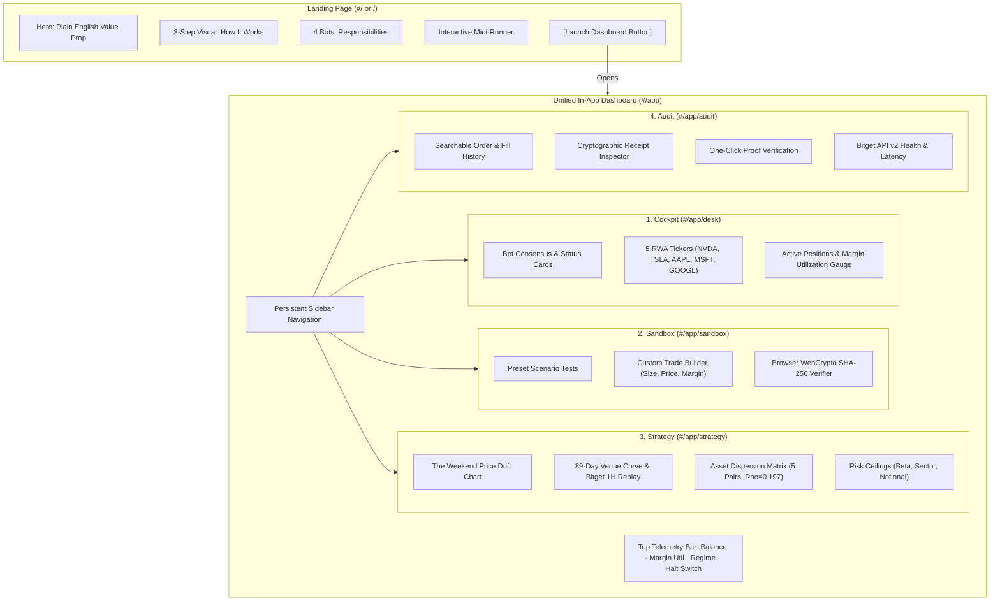

# Engineering Handoff: Landing Page Simplification & Dashboard Consolidation

**Project:** Money Boys (`packages/desk`)  
**Target:** In-App Dashboard Consolidation & Plain-Language Landing Page  
**Status:** Architecture Approved — Ready for Implementation Agent  
**Governing Standard:** `AGENTS.md` (Invariants I-01 through I-05)

---

## 1. Executive Summary & Goals

### The Problem
Currently, the Money Boys web app is fragmented across **6+ separate, disconnected pages** (`#/track1`, `#/track2`, `#/track3`, `#/repro`, `#/sandbox`, `#/desk`, `#/evidence`). A visitor or evaluator clicking around encounters disjointed full-page layouts ("separate pages of nothing"), losing context and requiring constant browser back-button navigation. Furthermore, the existing landing page suffers from **cryptic quant jargon** ("basis dislocation equilibrium synthetic rToken gamma dispersion") that obscures the core product value.

### The Solution
1. **Radically Simplified Landing Page (`#/` or `/`):**
   * Uses **plain, common, everyday human language** that anyone can understand in 10 seconds.
   * Explains what Money Boys does: *Trades tokenized US stocks 24/7 on crypto rails when Wall Street is closed, profiting from price differences with strict, unbreakable safety limits.*
   * "Boring but interesting" presentation: clear visual diagrams, real historical numbers, interactive widget, and a single prominent primary CTA: **`[Launch Desk Dashboard →]`**.

2. **Unified In-App Dashboard (`#/app` / `#/desk`):**
   * **Folds all 6 scattered pages into a single cohesive workspace.**
   * Features a **persistent, responsive sidebar** with 4 clear top-level tabs:
     1. **Cockpit (Live Desk):** Real-time bot matrix, margin telemetry, 5 asset tickers, emergency halt.
     2. **Sandbox (Try It Live):** Interactive scenario runner, custom trade builder, browser SHA-256 seal tester.
     3. **Strategy & Charts (The Edge):** The weekend convergence chart, 89-day walk-forward curves, correlation matrix, risk caps.
     4. **Audit & Receipts (Proof):** Searchable trade ledger, receipt inspector, one-click browser verifier, API health.
   * Each tab contains organized **sub-views / sub-tabs** to keep all features discoverable in one place without jumping across isolated web pages.
   * **100% Backward Compatible:** Preserves all existing URL hashes (`#/desk`, `#/sandbox`, `#/evidence`, `#/track1`, etc.) by routing them directly to their corresponding dashboard tab, ensuring all 61 existing Playwright tests continue passing without regression.

---

## 2. Landing Page Copywriting & Content Specification

The landing page must completely avoid impenetrable buzzwords. Replace them with plain analogies and clear statements:

### A. Hero Section
* **Badge:** `Autonomous Trading Desk · Active 24/7 on Bitget`
* **Headline:** *"Trade US Stocks Around the Clock — Automatically and Safely."*
* **Sub-headline:**  
  *"When Wall Street closes on Friday afternoon, crypto markets keep trading tokenized stocks like Nvidia, Apple, and Tesla. Money Boys automatically catches the price differences and earns profit when prices snap back together. Four specialized bots check every single trade before risking any money."*
* **Primary CTA:** `[Launch Desk Dashboard →]` (Navigates to `#/app/desk`)
* **Secondary CTA:** `[Try a Test Trade in Browser]` (Smooth scrolls to the embedded interactive widget)
* **Proof Strip (3 Authoritative Venue Metrics):**
  * **+$1,228.83 Net Return (+4.92%):** Authentic 89-day venue backtest across 150 trades on Bitget candles.
  * **3.89 Out-of-Sample Sharpe Ratio:** 30-day out-of-sample window (56.3% OOS win rate, 0.49% max DD).
  * **0 Direct AI Keys:** Every order is gated by deterministic math and SHA-256 receipts before dispatch.

### B. "How We Make Money" (3 Simple Steps)
1. **Step 1: Wall Street Closes, Crypto Stays Open**  
   *Plain English:* Regular US stock exchanges close every Friday at 4:00 PM EST. However, tokenized stocks on Bitget trade all weekend long.
2. **Step 2: Prices Drift Apart**  
   *Plain English:* During the weekend, crypto traders push tokenized stock prices slightly higher or lower than the real Friday closing price.
3. **Step 3: Bots Capture the Gap**  
   *Plain English:* Money Boys identifies when a tokenized stock is temporarily too cheap or too expensive. It buys the cheap token and sells when the price returns to normal, locking in the spread.

### C. "Meet the Four Bots" (The Desk Council)
* **Macro Boy (The Watcher):** Checks the broader market trend and news. Proposes opportunities, but cannot place trades or touch account keys directly.
* **Quant Boy (The Mathematician):** Calculates the exact fair value and price gap down to the fraction of a cent.
* **Risk Boy (The Bouncer):** The absolute law. Instantly vetoes any trade larger than $5,000, any trade pushing margin above 65%, or any trade during volatile news.
* **Execution Boy (The Dispatcher):** Calculates precise position size, generates an unforgeable SHA-256 digital receipt, and dispatches the order to Bitget.

### D. Interactive "Try It Live" Teaser
* An embedded mini-version of the Council Sandbox right on the landing page:
  * Dropdown: "Pick a Scenario" (`[Weekend Drift]`, `[Normal Market]`, `[Excessive Risk]`).
  * Big visual decision box: shows the 4 bots voting in real time (<50ms) with `APPROVED` (Green) or `HARD_VETO` (Red).
  * Direct link: *"Want to test custom order sizes and margin levels? Open the Full Sandbox in the Dashboard →"*.

---

## 3. In-App Dashboard Architecture Specification



### Dashboard Shell Components
* **Layout:** `DashboardLayout.tsx`
  * Persistent Sidebar (Width: 240px desktop, collapsible to icon-rail or slide-out drawer on mobile).
  * Top Telemetry Bar (`TopBar.tsx`):
    * Real-time paper balance: `$10,000.00 USDT`
    * Margin Utilization gauge with color bands (Green: <50%, Amber: 50-65%, Red: >65% VETO)
    * Current market regime pill: `TRADFI CLOSED / WEEKEND OPPORTUNITY` or `REGULAR SESSION`
    * Emergency Halt Kill-Switch button
  * Content Outlet: Renders the active tab and subpage cleanly without reloading the shell.

### Tab 1: Cockpit / Live Desk (`#/app/desk`)
* **Purpose:** Real-time operational overview of the automated desk.
* **Folds in:** Existing `DeskPage.tsx`, `NodeMatrix.tsx`, `QuorumGate.tsx`.
* **Sub-views:**
  1. *Bot Heartbeat & Matrix:* Cards for Macro, Quant, Risk, Execution showing online status, current proposal, vote tally, and last cycle timestamp.
  2. *Live Asset Tickers:* Real-time cards for `rNVDA`, `rTSLA`, `rAAPL`, `rMSFT`, `rGOOGL` with live prices, equilibrium fair values, and basis divergence in bps.
  3. *Active Position & Orders:* Live paper trading position (e.g. `NVDAUSDT` Long 1.26 contracts @ $236.37) with target exit (+120 bps) and stop loss (-65 bps).

### Tab 2: Interactive Sandbox (`#/app/sandbox`)
* **Purpose:** Allow visitors, traders, and judges to test the desk directly in the browser.
* **Folds in:** Existing `SandboxPage.tsx`, `CouncilSandbox.tsx`, `OnboardingModal.tsx`.
* **Sub-views:**
  1. *Curated Scenarios:* One-click buttons to simulate:
     * `Weekend Basis Drift` (Edge present -> Approved).
     * `Trending Momentum Breakout` (Structural drift -> Gated by SMA80).
     * `Excessive Trade Size` (Notional > $5,000 -> Risk Boy HARD_VETO).
     * `Margin Saturation` (Margin > 65% -> Risk Boy HARD_VETO).
  2. *Custom Trade Builder:* Sliders for Token Price, Order Notional, and Account Margin; runs the browser council engine in <50ms with zero server mutation.
  3. *Tamper Tester:* Generates a genuine SHA-256 seal using `crypto.subtle.digest`, with an interactive button to tamper with the payload and watch the verifier catch the fraud.

### Tab 3: Strategy & Charts (`#/app/strategy`)
* **Purpose:** "Boring but interesting" quantitative and visual proof of how the strategy works.
* **Folds in:** Existing `Track1Page.tsx`, `Track3Page.tsx`, correlation matrices, and backtest data.
* **Sub-views:**
  1. *The Weekend Basis Chart:* Visual comparison showing the tokenized price drifting on weekends while the cash reference is static, followed by convergence at Monday open.
  2. *Walk-Forward Backtests:* Interactive equity curves:
     * 89-day multi-asset venue backtest (+4.92% net return, 3.89 OOS Sharpe, 1.27% max DD).
     * 999-hour Bitget Cloud replay (+15.01 USDT net PnL, 60% win rate, 1.74 net PF).
  3. *Asset Dispersion Matrix:* Interactive 5x5 correlation heatmap demonstrating how trading 5 uncorrelated assets ($\rho = 0.197$, $N_{\text{eff}} = 2.80$) stabilizes the equity curve.
  4. *Risk Ceilings & Portfolio Copilot:* Clear gauges showing portfolio beta limit ($\le 2.50$), single sector cap ($\le 60\%$), and trade size caps.

### Tab 4: Audit & Receipts (`#/app/audit`)
* **Purpose:** Provide indisputable evidence and provenance for every action taken.
* **Folds in:** Existing `AuditLedger.tsx`, `EvidencePage.tsx`, `ReproPage.tsx`, and `Verifier.tsx`.
* **Sub-views:**
  1. *Order & Fill Ledger:* Filterable table of every trade, showing symbol, timestamp, entry/exit prices, fees, and realized PnL.
  2. *Cryptographic Receipt Inspector:* Clicking any trade expands its complete SHA-256 Reasoning Receipt, displaying bot votes, input hashes, and cryptographic signatures.
  3. *Browser One-Click Verifier:* An embedded verification tool that recalculates the SHA-256 hash in real time using the browser's WebCrypto API.
  4. *Venue API Health:* Real-time status of Bitget API v2 connections, WebSocket ping latency, and venue contract specifications.

---

## 4. File-by-File Implementation Plan for the Coding Agent

### A. New Components & Layouts to Create

1. **`packages/desk/src/layouts/DashboardLayout.tsx`**
   * Renders the persistent `Sidebar`, the `TopBar`, and the active tab content via `<main>`.
   * Manages active tab state and subpage selection.
   * Handles responsive mobile drawer navigation.

2. **`packages/desk/src/components/dashboard/Sidebar.tsx`**
   * Displays the Money Boys branding.
   * 4 master nav items with clean SVG icons:
     * `[Desk / Cockpit]` (`#/app/desk`)
     * `[Try It / Sandbox]` (`#/app/sandbox`)
     * `[Strategy / Charts]` (`#/app/strategy`)
     * `[Audit / Receipts]` (`#/app/audit`)
   * Bottom utilities: link back to Landing Page (`#/`), documentation link, and theme/status indicators.

3. **`packages/desk/src/pages/dashboard/DashboardPage.tsx`**
   * Master dashboard container. Reads the current tab and subpage from the URL hash or local state.
   * Renders:
     * Tab 1: `DeskTab.tsx`
     * Tab 2: `SandboxTab.tsx`
     * Tab 3: `StrategyTab.tsx`
     * Tab 4: `AuditTab.tsx`

4. **`packages/desk/src/pages/dashboard/tabs/DeskTab.tsx`**
   * Integrates `NodeMatrix`, `TickerFeed`, `QuorumGate`, and active position status.

5. **`packages/desk/src/pages/dashboard/tabs/SandboxTab.tsx`**
   * Embeds `CouncilSandbox` with preset scenario selectors and the tamper-testing verifier.

6. **`packages/desk/src/pages/dashboard/tabs/StrategyTab.tsx`**
   * Combines the equity charts, backtest statistics, correlation heatmap, and portfolio risk sliders.

7. **`packages/desk/src/pages/dashboard/tabs/AuditTab.tsx`**
   * Combines `AuditLedger`, the receipt inspector, the WebCrypto verifier, and venue evidence telemetry.

8. **`packages/desk/src/pages/landing-v2/SimpleLanding.tsx` (or update `LandingV2.tsx`)**
   * Replaces dense quant text with the plain-language copy detailed in Section 2.
   * Keeps the sleek obsidian aesthetic, high-res hero image, and smooth typography.
   * Embeds the simplified mini-simulator teaser.
   * Directs all primary actions to `#/app/desk`.

### B. Routing & Hash Compatibility Update (`packages/desk/src/App.tsx`)

Update `App.tsx` to route all historical and new hashes seamlessly:

```typescript
// Routing mapping in App.tsx:
function route() {
  const h = window.location.hash;
  
  // Dashboard routes
  if (h.startsWith("#/app") || h.startsWith("#/dashboard")) return "dashboard";
  if (h.startsWith("#/desk")) return "dashboard-desk";
  if (h.startsWith("#/sandbox") || h.startsWith("#/test")) return "dashboard-sandbox";
  if (h.startsWith("#/strategy") || h.startsWith("#/track1") || h.startsWith("#/track3")) return "dashboard-strategy";
  if (h.startsWith("#/audit") || h.startsWith("#/evidence") || h.startsWith("#/repro")) return "dashboard-audit";
  
  // Default to simplified landing page
  return "landing";
}
```

*When any of the `dashboard-*` routes are matched, `DashboardPage` receives the corresponding initial tab, preserving 100% backward compatibility for all existing tests and external links!*

---

## 5. Verification Checklist for the Coding Agent

Before completing the task, the implementation agent must run and verify:

1. **Type Safety & Build:**
   ```bash
   pnpm --filter @money-boys/desk build
   ```
   *Must exit with code 0 and zero TypeScript errors.*

2. **Foundry Compliance Check:**
   ```bash
   pnpm check-foundry
   ```
   *Must confirm all project charter invariants remain satisfied.*

3. **Playwright End-to-End Suite:**
   ```bash
   pnpm --filter @money-boys/desk test:e2e
   ```
   *All existing hash navigations (`#/desk`, `#/evidence`, `#/`) must resolve and pass.*

4. **Visual & Responsive Inspection:**
   * Test at `1440px` (Desktop sidebar expanded).
   * Test at `768px` (Tablet sidebar collapsed/icon rail).
   * Test at `375px` (Mobile bottom navigation / drawer).
   * Verify that no pages result in "dead ends" or require manual browser back-button navigation.

---

## 6. Summary Handoff Message for the Next Agent

> *"The architecture and requirements for consolidating Money Boys into a unified In-App Dashboard and simplifying the Landing Page are fully specified in this document. Implement the `DashboardLayout`, fold the 6 fragmented pages into the 4 unified dashboard tabs (`Desk`, `Sandbox`, `Strategy`, `Audit`), update `LandingV2` with plain everyday language, and ensure hash-routing backward compatibility so all tests pass cleanly."*
